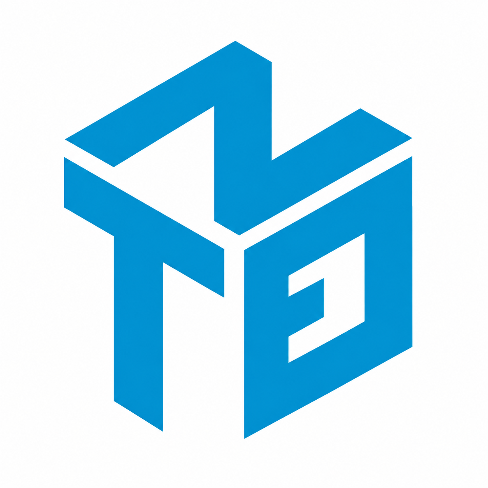

# DESIGN CONCEPT


- **Visual direction:** nhận diện từ logo hình học xanh cyan do chủ website cung cấp. Nền trắng, khối vuông, đường kẻ rõ và khoảng trắng; NhaTro giữ khu vực riêng và case study mở rộng được.
- **Color palette:** nền `#ffffff`, chữ navy `#163343`, chữ phụ `#546b78`, xanh nhận diện `#0098cc`. Dùng xanh đậm `#00769f` cho nút/chữ để dễ đọc; nền khối xanh rất nhạt `#f1f7fa`.
- **Typography:** Arial/Helvetica cho nội dung và tiêu đề, Courier New cho nhãn kỹ thuật. Chữ sans-serif phù hợp hình học logo; font hệ thống, không tải font bên ngoài.
- **Layout:** header kết hợp logo và tên; hero đặt tên, vai trò, giới thiệu, CTA bên trái, logo lớn và luồng Database → API → Frontend bên phải. Mobile đưa logo thành dải nhận diện gọn. Tiếp theo là NhaTro, kiến trúc, kinh nghiệm, stack, cách làm việc và liên hệ. Footer và favicon dùng cùng logo.
- **Phù hợp hồ sơ:** đặt .NET và kinh nghiệm IVS ngay đầu; phân biệt React của dự án cá nhân với frontend commercial tại IVS. Không thêm số liệu, sản phẩm, khách hàng hay thành tích chưa được cung cấp.


Toàn bộ các file dưới đây là bản thiết kế hiện tại theo logo gốc.

## index.html

```html
<!doctype html>
<html lang="en">
<head>
  <meta charset="utf-8">
  <meta name="viewport" content="width=device-width, initial-scale=1">
  <meta name="theme-color" content="#ffffff">
  <title>Nguyễn Thanh Đăng — C# / .NET Developer</title>
  <meta name="description" content="Nguyễn Thanh Đăng, C# / .NET Developer in Cần Thơ, Vietnam. Professional experience at IVS and NhaTro, a .NET 8, React and PostgreSQL rental management system in active development.">
  <meta property="og:type" content="website">
  <meta property="og:locale" content="en_US">
  <meta property="og:title" content="Nguyễn Thanh Đăng — C# / .NET Developer">
  <meta property="og:description" content="Practical web systems, from database and API to frontend. Explore NhaTro and my C# / .NET experience.">
  <!-- Add og:url and og:image with real absolute URLs after deployment. -->
  <link rel="icon" href="assets/images/logo.png" type="image/png">
  <link rel="stylesheet" href="css/style.css">
  <script src="js/script.js" defer></script>
</head>
<body>
  <a class="skip-link" href="#main">Skip to content</a>
  <header class="site-header">
    <div class="container header-inner">
      <a class="wordmark" href="#home" aria-label="Nguyễn Thanh Đăng, home">
        <span class="brand-icon"></span>
        <span class="brand-name">THANH ĐĂNG<span class="brand-caption">C# / .NET DEVELOPER</span></span>
      </a>
      <button class="menu-toggle" type="button" aria-expanded="false" aria-controls="main-nav" hidden>Menu <span aria-hidden="true">+</span></button>
      <nav id="main-nav" class="main-nav" aria-label="Main navigation">
        <a href="#work" data-nav>Selected work</a>
        <a href="#experience" data-nav>Experience</a>
        <a href="#about" data-nav>Approach</a>
        <a href="#contact" data-nav>Contact <span aria-hidden="true">↗</span></a>
      </nav>
    </div>
  </header>

  <main id="main">
    <section id="home" class="hero container" aria-labelledby="hero-title">
      <div class="hero-top"><span class="eyebrow">C# / .NET DEVELOPER</span><span class="location">Cần Thơ, Vietnam <span aria-hidden="true">↗</span></span></div>
      <div class="hero-grid">
        <div class="hero-copy">
          <h1 id="hero-title">Nguyễn<br>Thanh Đăng<span class="accent">.</span></h1>
          <div class="hero-intro">
            <p class="hero-statement">Practical web systems.<br> From database to <em>frontend.</em></p>
            <p>I build with C#/.NET, databases and modern frontend technologies. My work connects the API, the data and the interface.</p>
            <div class="hero-actions">
              <a class="button button-dark" href="#work">View NhaTro <span aria-hidden="true">↘</span></a>
              <a class="text-link" data-config-link="CV_URL" aria-disabled="true" role="link" title="CV has not been added">Download CV <span aria-hidden="true">↓</span></a>
              <a class="hero-contact text-link" href="#contact">Contact <span aria-hidden="true">↗</span></a>
            </div>
          </div>
        </div>
        <figure class="hero-brand" aria-label="Personal identity and fullstack focus">
          <div class="brand-art"></div>
          <figcaption><span class="meta-label">CONNECTED BY DESIGN</span><span class="brand-flow"><span>Database</span><span aria-hidden="true">→</span><span>API</span><span aria-hidden="true">→</span><span>Frontend</span></span></figcaption>
        </figure>
      </div>
      <div class="hero-facts">
        <div><span class="meta-label">CORE STACK</span><p>C# / .NET / PostgreSQL</p></div>
        <div><span class="meta-label">PROFESSIONAL EXPERIENCE</span><p>IVS / ABD-CTO <span class="muted">· 2024–2026</span></p></div>
        <a class="current-project" href="#work"><span class="meta-label">CURRENT PERSONAL PROJECT</span><p><span class="status-dot" aria-hidden="true"></span>NhaTro <span aria-hidden="true">↗</span></p></a>
      </div>
    </section>

    <section id="work" class="work-section section-pad" aria-labelledby="work-title">
      <div class="container">
        <div class="section-heading"><p class="eyebrow"><span>01 /</span> SELECTED WORK</p><span class="section-aside">A system I’m continuing to build.</span></div>
        <article class="featured-project">
          <div class="project-heading">
            <div><h2 id="work-title">NhaTro<span class="accent">↗</span></h2><p class="project-subtitle">Rental Management System</p></div>
            <span class="status"><span class="status-dot" aria-hidden="true"></span><span data-project-status>ACTIVE DEVELOPMENT</span></span>
          </div>
          <div class="project-overview">
            <p class="project-lead">One project.<br>The whole web stack.</p>
            <div><p>A personal rental management system built from API to frontend. I’m continuing to rebuild and deploy it, with work spanning authentication, role-based access and rental management.</p><a class="text-link" href="#case-study">Explore the case study <span aria-hidden="true">↘</span></a></div>
          </div>
          <ul class="tag-list" aria-label="NhaTro technology stack"><li>.NET 8</li><li>React</li><li>TypeScript</li><li>PostgreSQL</li><li>EF Core</li><li>JWT</li><li>Hangfire</li></ul>
          <div class="preview-heading"><h3>Selected screens</h3><span class="meta-label">PRODUCT PREVIEW</span></div>
          <div class="screens-grid">
            <!-- Add real screenshots at these paths. Missing images use the fallback. -->
            <figure class="screen screen-main"><button class="screen-open" type="button" disabled aria-label="Enlarge NhaTro dashboard screenshot"><span class="screen-placeholder"><span class="placeholder-mark" aria-hidden="true">N<span>.</span></span><span class="placeholder-title">The product, in progress.</span><span class="placeholder-note">Dashboard screenshot to be added</span></span></button><figcaption><span>01 — Dashboard</span><span data-screen-state>AWAITING SCREENSHOT</span></figcaption></figure>
            <figure class="screen"><button class="screen-open" type="button" disabled aria-label="Enlarge NhaTro login screenshot"><span class="screen-placeholder"><span class="placeholder-index" aria-hidden="true">02</span><span class="placeholder-title">Authentication</span><span class="placeholder-note">Login screenshot to be added</span></span></button><figcaption><span>02 — Login</span><span data-screen-state>AWAITING SCREENSHOT</span></figcaption></figure>
            <figure class="screen"><button class="screen-open" type="button" disabled aria-label="Enlarge NhaTro tenant management screenshot"><span class="screen-placeholder"><span class="placeholder-index" aria-hidden="true">03</span><span class="placeholder-title">Tenant management</span><span class="placeholder-note">Tenant screenshot to be added</span></span></button><figcaption><span>03 — Tenants</span><span data-screen-state>AWAITING SCREENSHOT</span></figcaption></figure>
          </div>
          <p class="preview-note">Screenshots will be added as the rebuild progresses. These frames are placeholders, not product screenshots.</p>
          <div class="project-links"><a class="text-link" data-config-link="NHATRO_DEMO_URL" aria-disabled="true" role="link" title="Live demo has not been added">Live demo <span aria-hidden="true">↗</span></a><a class="text-link" data-config-link="NHATRO_CODE_URL" aria-disabled="true" role="link" title="Source code URL has not been added">View code <span aria-hidden="true">↗</span></a><span class="muted">Links become available when added.</span></div>
        </article>
      </div>
    </section>

    <section id="case-study" class="case-section section-pad container" aria-labelledby="case-title">
      <div class="section-heading"><p class="eyebrow"><span>02 /</span> UNDER THE HOOD</p><span class="section-aside">NhaTro / Case study</span></div>
      <div class="section-intro"><h2 id="case-title">Built to connect<br>the moving parts<span class="accent">.</span></h2><p>Frontend, API and database, with authentication, authorization and background processing.</p></div>
      <div class="architecture" aria-label="NhaTro architecture">
        <ol class="architecture-flow"><li><span class="meta-label">01 / INTERFACE</span><strong>React + TypeScript</strong><span>Vite · Tailwind CSS</span></li><li><span class="meta-label">02 / API</span><strong>ASP.NET Core</strong><span>.NET 8 · REST API</span></li><li><span class="meta-label">03 / DATA ACCESS</span><strong>Entity Framework Core</strong><span>Database access</span></li><li><span class="meta-label">04 / DATABASE</span><strong>PostgreSQL</strong><span>Data storage</span></li></ol>
        <div class="architecture-services"><div><span class="meta-label">AUTHENTICATION</span><strong>JWT</strong></div><div><span class="meta-label">AUTHORIZATION</span><strong>RBAC</strong></div><div><span class="meta-label">BACKGROUND JOBS</span><strong>Hangfire</strong></div><div><span class="meta-label">LANGUAGES</span><strong>i18n / database internationalization</strong></div></div>
      </div>
      <div class="case-details">
        <div class="case-item"><h3>The problem</h3><p>Managing properties, rentals and tenants in a single system.</p><p class="editor-note">[ADD PROJECT DETAILS: the specific workflow and problem context]</p></div>
        <div class="case-item"><h3>The solution</h3><p>A web system with a React frontend, an ASP.NET Core API and PostgreSQL. Scope includes property/rental management, tenant management, database management, authentication and authorization.</p></div>
        <div class="case-item"><h3>My role</h3><p>Fullstack Developer · Personal project</p><p class="editor-note">[ADD PROJECT DETAILS: what I personally implemented]</p></div>
        <div class="case-item"><h3>Access & roles</h3><p>Admin / Manager / Tenant</p><p>JWT authentication and role-based access control.</p></div>
      </div>
      <details class="case-expansion" open><summary>Development notes <span aria-hidden="true">+</span></summary><div class="development-grid"><div><h3>Technical challenges</h3><p class="editor-note">[ADD PROJECT DETAILS: a technical challenge, the approach and the outcome]</p></div><div><h3>Current status</h3><p data-project-current>Currently rebuilding and deploying the system.</p></div><div><h3>What’s next</h3><p class="editor-note" data-project-next>[ADD PROJECT DETAILS: the next development milestone]</p></div></div></details>
      <p class="case-footnote">This case study will grow with the project. The scope above includes features already built or under development.</p>
    </section>

    <section id="experience" class="experience-section section-pad" aria-labelledby="experience-title"><div class="container">
      <div class="section-heading"><p class="eyebrow"><span>03 /</span> EXPERIENCE</p><span class="section-aside">The work behind the skills.</span></div>
      <h2 id="experience-title">Practical experience.<br>Different contexts.</h2>
      <article class="experience-row"><div class="experience-meta"><span class="meta-label">08/2026 — PRESENT</span><span class="experience-kind">Web content & automation</span></div><div class="experience-body"><h3>Đăng Nguyên <span class="small-label">CURRENT</span></h3><p>Work with WordPress, web content and image processing. Use AI and lightweight automation to reduce repetitive manual work.</p><ul class="plain-list"><li>Image conversion and renaming.</li><li>Small automation tools and scripts.</li><li>AI-assisted content workflows.</li></ul><ul class="tag-list"><li>WordPress</li><li>Web content</li><li>Image processing</li><li>Automation</li></ul></div></article>
      <article class="experience-row"><div class="experience-meta"><span class="meta-label">12/2024 — 07/2026</span><span class="experience-kind">Professional development</span></div><div class="experience-body"><h3>IVS / ABD-CTO</h3><p class="job-title">C# / .NET Developer</p><p>Worked with C#/.NET and web interfaces using ASP.NET MVC, ASP.NET WebForms, DevExpress, HTML, CSS and JavaScript.</p><div class="work-highlight"><span class="meta-label">SELECTED CONTRIBUTION</span><h4>Sport_Event API <span aria-hidden="true">↗</span></h4><p>Contributed to a C#/.NET API using PostgreSQL and Dapper for data access and business logic.</p><span class="work-context">Professional work at IVS / ABD-CTO</span></div><ul class="tag-list"><li>C#</li><li>.NET Framework</li><li>ASP.NET MVC / WebForms</li><li>DevExpress</li><li>MySQL</li><li>Devart</li><li>PostgreSQL</li><li>Dapper</li><li>REST API</li><li>Git</li><li>Jenkins</li></ul></div></article>
    </div></section>

    <section id="stack" class="stack-section section-pad container" aria-labelledby="stack-title">
      <div class="section-heading"><p class="eyebrow"><span>04 /</span> TOOLKIT</p><span class="section-aside">Skills, with their context.</span></div>
      <div class="section-intro"><h2 id="stack-title">The stack.<br>And where I use it.</h2><p>Commercial work, personal development and foundations each have their own place.</p></div>
      <div class="stack-row"><div><span class="meta-label">01 / PROFESSIONAL</span><h3>In practice at IVS</h3></div><p>C# · .NET Framework · ASP.NET MVC · WebForms · DevExpress · HTML · CSS · JavaScript · MySQL · Devart · PostgreSQL · Dapper · REST API · Git · Jenkins</p></div>
      <div class="stack-row"><div><span class="meta-label">02 / PERSONAL PROJECT</span><h3>Building NhaTro</h3></div><p>.NET 8 · ASP.NET Core Web API · EF Core · PostgreSQL · JWT · RBAC · React · TypeScript · Vite · Tailwind CSS · Hangfire · i18n</p></div>
      <div class="stack-row"><div><span class="meta-label">03 / ACADEMIC & FOUNDATION</span><h3>The groundwork</h3></div><p>Node.js · HTML · CSS · JavaScript · Frontend fundamentals</p></div>
    </section>

    <section id="about" class="approach-section section-pad" aria-labelledby="approach-title"><div class="container">
      <div class="section-heading"><p class="eyebrow"><span>05 /</span> HOW I WORK</p><span class="section-aside">Fullstack thinking / Marketing tech & automation</span></div>
      <div class="section-intro"><h2 id="approach-title">Understand the problem.<br>Then make it work.</h2><p>I like to understand the task, connect the parts and find ways to make repetitive work easier.</p></div>
      <ol class="process-list"><li><span>01</span><h3>Understand</h3><p>Start with the problem and the people doing the work.</p></li><li><span>02</span><h3>Build</h3><p>Turn the requirements into a practical solution.</p></li><li><span>03</span><h3>Connect</h3><p>Bring the database, API and interface together.</p></li><li><span>04</span><h3>Automate</h3><p>Use small tools and AI to cut repetitive steps.</p></li><li><span>05</span><h3>Improve</h3><p>Keep learning, revisit decisions and refine the system.</p></li></ol>
      <div class="education"><h3 class="meta-label">EDUCATION</h3><p class="editor-note">[ADD EDUCATION DETAILS: institution, qualification and dates]</p></div>
    </div></section>

    <section id="contact" class="contact-section section-pad container" aria-labelledby="contact-title">
      <div class="section-heading"><p class="eyebrow"><span>06 /</span> CONTACT</p><span class="section-aside">Cần Thơ, Vietnam</span></div>
      <div class="contact-grid"><h2 id="contact-title">Have something<br>to build<span class="accent">?</span></h2><div><p>For C#/.NET, fullstack development or practical automation work, get in touch.</p><div class="email-row"><a class="email-link" data-email-link aria-disabled="true" role="link">YOUR_EMAIL</a><button class="copy-email" type="button" disabled aria-label="Copy email address" title="Add an email address in CONFIG">Copy <span aria-hidden="true">↗</span></button></div><p class="contact-note" data-contact-note>Contact details will be added here.</p><div class="social-links"><a class="text-link" data-config-link="GITHUB_URL" aria-disabled="true" role="link" title="GitHub URL has not been added">GitHub ↗</a><a class="text-link" data-config-link="LINKEDIN_URL" aria-disabled="true" role="link" title="LinkedIn URL has not been added">LinkedIn ↗</a><a class="text-link" data-config-link="CV_URL" aria-disabled="true" role="link" title="CV has not been added">Download CV ↓</a></div></div></div>
    </section>
  </main>
  <footer class="site-footer container"><span class="footer-identity"><span>© <span data-year>2026</span> Nguyễn Thanh Đăng</span></span><span>Built with HTML, CSS & a little JavaScript.</span><a href="#home" class="text-link">Back to top ↑</a></footer>
  <dialog class="lightbox" aria-label="NhaTro screenshot preview"><button class="lightbox-close" type="button" aria-label="Close screenshot preview">Close ×</button><p class="lightbox-caption"></p></dialog>
  <p class="sr-only" role="status" aria-live="polite" data-announcement></p>
</body>
</html>

```

## css/style.css

```css
/* Brand system: original cyan logo, white surfaces and deep navy typography. */
:root {
  --paper:#ffffff;
  --ink:#163343;
  --muted:#546b78;
  --brand:#0098cc;
  --accent:#00769f;
  --line:#d6e5ec;
  --panel:#f1f7fa;
  --brand-soft:#e5f3f9;
  --font:Arial,Helvetica,sans-serif;
  --mono:"Courier New",monospace;
  --width:1200px;
}

* {
  box-sizing:border-box;
}

html {
  scroll-behavior:smooth;
  scroll-padding-top:100px;
}

body {
  margin:0;
  background:var(--paper);
  color:var(--ink);
  font-family:var(--font);
  font-size:16px;
  line-height:1.65;
  -webkit-font-smoothing:antialiased;
}

body.modal-open {
  overflow:hidden;
}

::selection {
  background:var(--accent);
  color:var(--paper);
}

a {
  color:inherit;
  text-decoration:none;
}

button {
  font:inherit;
  color:inherit;
}

button,a {
  -webkit-tap-highlight-color:transparent;
}

button:not(:disabled),summary {
  cursor:pointer;
}

button:disabled,[aria-disabled="true"] {
  cursor:default;
}

a[aria-disabled="true"] {
  color:var(--muted);
  opacity:.7;
}

:focus-visible {
  outline:2px solid var(--accent);
  outline-offset:6px;
}

h1,h2,h3,h4,p,figure {
  margin:0;
}

h1,h2,h3,h4 {
  font-weight:500;
}

h2 {
  font-size:clamp(36px,4.3vw,60px);
  line-height:1.08;
  letter-spacing:-2.7px;
}

h3 {
  font-size:21px;
  line-height:1.3;
  letter-spacing:-.5px;
}

p+p {
  margin-top:12px;
}

img {
  max-width:100%;
  display:block;
}

[hidden] {
  display:none!important;
}

.container {
  width:min(var(--width),calc(100% - 112px));
  margin-inline:auto;
}

.section-pad {
  padding-block:92px;
}

.accent {
  color:var(--accent);
}

.muted {
  color:var(--muted);
}

.eyebrow,.meta-label,.section-aside,.small-label,.status,.screen figcaption,.work-context,.preview-note,.case-footnote,.contact-note {
  font-family:var(--mono);
  font-size:11px;
  line-height:1.5;
  letter-spacing:.7px;
}

.eyebrow {
  font-weight:700;
  letter-spacing:1.4px;
}

.eyebrow>span {
  color:var(--accent);
  margin-right:16px;
}

.meta-label {
  display:block;
  color:var(--muted);
  font-weight:400;
}

.section-heading {
  display:flex;
  justify-content:space-between;
  align-items:center;
  gap:24px;
  margin-bottom:46px;
}

.section-aside {
  color:var(--muted);
  text-align:right;
  letter-spacing:0;
}

.text-link {
  display:inline-flex;
  gap:24px;
  align-items:center;
  font-size:13px;
  font-weight:600;
  line-height:1.5;
  padding-block:6px;
  border-bottom:1px solid currentColor;
  transition:color .2s;
}

.text-link[href]:hover {
  color:var(--accent);
}

.button {
  display:inline-flex;
  justify-content:space-between;
  align-items:center;
  gap:36px;
  padding:15px 22px;
  font-size:13px;
  font-weight:600;
  transition:background .2s;
}

.button-dark {
  background:var(--accent);
  color:var(--paper);
}

.button-dark:hover {
  background:var(--ink);
}

.skip-link {
  position:fixed;
  top:8px;
  left:8px;
  z-index:20;
  background:var(--ink);
  color:var(--paper);
  padding:12px;
  transform:translateY(-150%);
}

.skip-link:focus {
  transform:none;
}

.site-header {
  position:sticky;
  top:0;
  z-index:10;
  background:var(--paper);
  border-bottom:1px solid var(--line);
}

.header-inner {
  height:88px;
  display:flex;
  align-items:center;
  gap:30px;
}

.wordmark {
  display:flex;
  align-items:center;
  gap:12px;
  flex-shrink:0;
}

.brand-icon {
  position:relative;
  width:46px;
  height:52px;
  overflow:hidden;
  background:#fff;
}

.brand-icon img {
  position:absolute;
  max-width:none;
  width:60px;
  height:60px;
  left:50%;
  top:50%;
  transform:translate(-50%,-50%);
}

.brand-name {
  font-size:13px;
  font-weight:700;
  line-height:1.3;
  letter-spacing:1.2px;
}

.brand-caption {
  display:block;
  font-family:var(--mono);
  font-size:8px;
  font-weight:400;
  letter-spacing:1px;
  margin-top:5px;
  color:var(--muted);
}

.main-nav {
  margin-left:auto;
  display:flex;
  gap:30px;
}

.main-nav a {
  font-size:12px;
  padding-block:12px;
  position:relative;
}

.main-nav a:hover,.main-nav a[aria-current] {
  color:var(--accent);
}

.main-nav a[aria-current]::after {
  content:"";
  height:2px;
  width:100%;
  background:var(--brand);
  position:absolute;
  bottom:2px;
  left:0;
}

.hero {
  padding-top:32px;
}

.hero-top {
  display:flex;
  justify-content:space-between;
  gap:24px;
  align-items:center;
}

.hero-top .eyebrow {
  font-size:13px;
}

.location {
  font-family:var(--mono);
  font-size:11px;
  color:var(--muted);
}

.location>span {
  color:var(--accent);
  margin-left:16px;
}

.hero-grid {
  display:grid;
  grid-template-columns:1.25fr 1fr;
  gap:70px;
  padding-block:34px 40px;
  align-items:center;
}

h1 {
  font-size:clamp(64px,6.3vw,88px);
  line-height:1.02;
  letter-spacing:-5px;
  font-weight:600;
}

.hero-intro {
  margin-top:24px;
  max-width:500px;
}

.hero-statement {
  font-size:26px;
  line-height:1.25;
  letter-spacing:-.8px;
}

.hero-statement em {
  font-style:normal;
  font-weight:500;
  color:var(--accent);
}

.hero-intro>p:not(.hero-statement) {
  font-size:13px;
  color:var(--muted);
  line-height:1.8;
  margin-top:15px;
  max-width:430px;
}

.hero-actions {
  display:flex;
  align-items:center;
  gap:26px;
  margin-top:28px;
  flex-wrap:wrap;
}

.hero-contact {
  font-size:12px;
  border:0;
}

.hero-facts {
  display:grid;
  grid-template-columns:1fr 1.2fr 1fr;
  gap:32px;
  border-top:1px solid var(--line);
  padding-block:25px 32px;
}

.hero-facts p {
  font-size:13px;
  margin-top:6px;
}

.current-project p {
  display:flex;
  align-items:center;
  gap:8px;
}

.current-project p>span:last-child {
  margin-left:auto;
  color:var(--accent);
}

.status-dot {
  display:inline-block;
  width:6px;
  height:6px;
  flex-shrink:0;
  background:var(--accent);
  border-radius:50%;
}

.work-section {
  background:var(--panel);
  border-block:1px solid var(--line);
  padding-top:58px;
}

.project-heading {
  display:flex;
  justify-content:space-between;
  align-items:center;
  gap:24px;
}

.project-heading h2 {
  font-size:clamp(68px,8.8vw,124px);
  line-height:.95;
  letter-spacing:-6px;
  font-weight:600;
}

.project-heading h2>span {
  font-size:.58em;
  vertical-align:top;
  margin-left:20px;
}

.project-subtitle {
  font-size:17px;
  margin-top:16px;
}

.status {
  display:inline-flex;
  gap:9px;
  align-items:center;
  border:1px solid #b6d8e7;
  padding:9px 12px;
  color:var(--accent);
  font-size:10px;
  white-space:nowrap;
}

.project-overview {
  display:grid;
  grid-template-columns:.85fr 1fr;
  gap:90px;
  margin-block:36px 26px;
}

.project-lead {
  font-size:30px;
  line-height:1.2;
  letter-spacing:-1px;
}

.project-overview>div>p {
  font-size:14px;
  color:var(--muted);
  max-width:460px;
}

.project-overview .text-link {
  margin-top:15px;
}

.tag-list {
  list-style:none;
  display:flex;
  flex-wrap:wrap;
  gap:7px;
  margin:0;
  padding:0;
}

.tag-list li {
  font-family:var(--mono);
  font-size:10px;
  border:1px solid var(--line);
  padding:5px 9px;
  line-height:1.5;
}

.preview-heading {
  display:flex;
  justify-content:space-between;
  align-items:center;
  gap:16px;
  margin-block:43px 17px;
}

.preview-heading h3 {
  font-size:15px;
}

.screens-grid {
  display:grid;
  grid-template-columns:1.7fr 1fr;
  gap:22px;
}

.screen-main {
  grid-row:span 2;
  display:flex;
  flex-direction:column;
  justify-content:center;
  background:#deedf4;
  padding:28px;
}

.screen-open {
  position:relative;
  display:block;
  width:100%;
  aspect-ratio:16/10;
  padding:0;
  border:1px solid #c6dfe9;
  overflow:hidden;
  background:#eaf4f8;
  text-align:left;
}

.screen-open:not(:disabled):hover img {
  transform:scale(1.015);
}

.screen-open img {
  width:100%;
  height:100%;
  object-fit:contain;
  position:absolute;
  inset:0;
  background:var(--panel);
  transition:transform .3s;
}

.screen-placeholder {
  display:flex;
  flex-direction:column;
  justify-content:center;
  align-items:center;
  position:absolute;
  inset:0;
  padding:16px;
  text-align:center;
}

.placeholder-mark {
  font-size:94px;
  line-height:1;
  font-weight:500;
  letter-spacing:-9px;
  margin-bottom:22px;
}

.placeholder-mark>span {
  color:var(--accent);
}

.placeholder-index {
  font-family:var(--mono);
  font-size:42px;
  color:#63889b;
  line-height:1.1;
  margin-bottom:12px;
}

.placeholder-title {
  font-size:14px;
  letter-spacing:-.2px;
}

.placeholder-note {
  font-family:var(--mono);
  font-size:9px;
  color:var(--muted);
  margin-top:7px;
}

.screen figcaption {
  display:flex;
  justify-content:space-between;
  gap:10px;
  margin-top:10px;
  font-size:9px;
  letter-spacing:0;
}

.screen figcaption>span:last-child {
  color:var(--muted);
  font-size:8px;
  text-align:right;
}

.preview-note {
  color:var(--muted);
  letter-spacing:0;
  margin-top:17px;
  font-size:10px;
}

.project-links {
  display:flex;
  align-items:center;
  flex-wrap:wrap;
  gap:30px;
  margin-top:28px;
}

.project-links>.muted {
  font-size:11px;
}

.section-intro {
  display:grid;
  grid-template-columns:1.3fr 1fr;
  gap:80px;
  align-items:end;
  margin-bottom:44px;
}

.section-intro>p {
  max-width:360px;
  color:var(--muted);
  font-size:14px;
  padding-bottom:4px;
}

.architecture {
  border:1px solid var(--line);
  border-top:3px solid var(--brand);
  background:var(--panel);
  padding:31px 24px 0;
}

.architecture-flow {
  list-style:none;
  display:grid;
  grid-template-columns:repeat(4,minmax(0,1fr));
  margin:0;
  padding:0 0 32px;
  gap:30px;
}

.architecture-flow li {
  position:relative;
  display:flex;
  flex-direction:column;
  gap:11px;
}

.architecture-flow li:not(:last-child)::after {
  content:"→";
  position:absolute;
  right:-19px;
  top:37px;
  color:var(--accent);
}

.architecture-flow strong {
  font-size:16px;
  font-weight:600;
  line-height:1.3;
  letter-spacing:-.4px;
}

.architecture-flow li>span:last-child {
  font-size:11px;
  color:var(--muted);
}

.architecture-services {
  display:grid;
  grid-template-columns:.8fr .8fr 1fr 1.7fr;
  gap:24px;
  border-top:1px solid var(--line);
  padding-block:20px;
}

.architecture-services .meta-label {
  font-size:9px;
}

.architecture-services strong {
  display:block;
  font-size:12px;
  font-weight:400;
  margin-top:5px;
}

.case-details {
  display:grid;
  grid-template-columns:1fr 1fr;
  column-gap:65px;
  margin-top:22px;
}

.case-item {
  padding-block:26px;
  border-bottom:1px solid var(--line);
}

.case-item h3 {
  font-size:16px;
  margin-bottom:12px;
}

.case-item p {
  font-size:13px;
  color:var(--muted);
}

.editor-note {
  font-family:var(--mono);
  font-size:11px!important;
  line-height:1.8;
  color:var(--muted);
}

.case-expansion {
  margin-top:22px;
  border-bottom:1px solid var(--line);
}

.case-expansion summary {
  display:flex;
  justify-content:space-between;
  align-items:center;
  list-style:none;
  font-size:16px;
  padding-block:15px;
}

.case-expansion summary::-webkit-details-marker {
  display:none;
}

.case-expansion summary>span {
  font-size:24px;
  color:var(--accent);
}

.case-expansion[open] summary>span {
  transform:rotate(45deg);
}

.development-grid {
  display:grid;
  grid-template-columns:repeat(3,minmax(0,1fr));
  gap:34px;
  padding-block:18px 30px;
}

.development-grid h3 {
  font-size:14px;
  margin-bottom:10px;
}

.development-grid p {
  font-size:13px;
  color:var(--muted);
}

.case-footnote {
  color:var(--muted);
  font-size:10px;
  letter-spacing:0;
  margin-top:17px;
}

.experience-section {
  background:var(--paper);
  border-block:1px solid var(--line);
}

.experience-section h2 {
  margin-bottom:48px;
}

.experience-row {
  display:grid;
  grid-template-columns:1fr 2fr;
  gap:60px;
  border-top:1px solid var(--line);
  padding-block:34px 44px;
}

.experience-row:last-child {
  padding-bottom:0;
}

.experience-kind {
  display:block;
  font-size:12px;
  color:var(--muted);
  margin-top:10px;
}

.experience-body h3 {
  font-size:27px;
  display:flex;
  align-items:center;
  gap:17px;
  flex-wrap:wrap;
  margin-bottom:15px;
}

.small-label {
  font-size:9px;
  color:var(--accent);
  border:1px solid #b6d8e7;
  padding:3px 6px;
}

.experience-body>p {
  font-size:14px;
  color:var(--muted);
  max-width:640px;
}

.experience-body .job-title {
  color:var(--ink);
  font-size:16px;
  margin-top:-5px;
  margin-bottom:15px;
}

.plain-list {
  font-size:13px;
  color:var(--muted);
  padding-left:17px;
  margin-block:14px 23px;
}

.work-highlight {
  border-left:2px solid var(--brand);
  background:var(--panel);
  padding:20px 22px;
  margin-block:25px;
}

.work-highlight h4 {
  font-size:21px;
  letter-spacing:-.4px;
  margin-block:8px;
}

.work-highlight h4>span {
  font-size:15px;
  color:var(--accent);
  margin-left:10px;
}

.work-highlight p {
  font-size:13px;
  color:var(--muted);
}

.work-context {
  display:block;
  font-size:9px;
  color:var(--muted);
  margin-top:10px;
}

.stack-row {
  display:grid;
  grid-template-columns:1fr 1.7fr;
  gap:60px;
  border-top:1px solid var(--line);
  padding-block:28px;
}

.stack-row:last-child {
  border-bottom:1px solid var(--line);
}

.stack-row h3 {
  font-size:19px;
  margin-top:8px;
}

.stack-row>p {
  font-size:14px;
  color:var(--muted);
  line-height:2;
}

.approach-section {
  background:var(--panel);
  border-block:1px solid var(--line);
}

.process-list {
  list-style:none;
  display:grid;
  grid-template-columns:repeat(5,minmax(0,1fr));
  gap:28px;
  padding:0;
  margin:0;
}

.process-list li {
  border-top:1px solid var(--line);
  padding-top:18px;
}

.process-list li>span {
  font-family:var(--mono);
  font-size:13px;
  color:var(--accent);
}

.process-list h3 {
  font-size:19px;
  margin-block:18px 10px;
}

.process-list p {
  font-size:12px;
  color:var(--muted);
}

.education {
  display:grid;
  grid-template-columns:1fr 2fr;
  gap:30px;
  border-top:1px solid var(--line);
  margin-top:50px;
  padding-top:25px;
}

.contact-section {
  padding-top:70px;
}

.contact-grid {
  display:grid;
  grid-template-columns:1.2fr 1fr;
  gap:80px;
}

.contact-grid h2 {
  font-size:clamp(44px,5vw,70px);
  letter-spacing:-3px;
}

.contact-grid>div>p:first-child {
  font-size:14px;
  color:var(--muted);
  max-width:350px;
}

.email-row {
  display:flex;
  align-items:center;
  justify-content:space-between;
  gap:16px;
  border-bottom:1px solid var(--line);
  padding-block:24px 15px;
}

.email-link {
  font-size:clamp(16px,1.7vw,23px);
  letter-spacing:-.5px;
  overflow-wrap:anywhere;
  min-width:0;
}

.copy-email {
  font-family:var(--mono);
  font-size:10px;
  background:none;
  border:0;
  padding:7px 0;
  white-space:nowrap;
}

.copy-email:disabled {
  color:var(--muted);
}

.copy-email:not(:disabled):hover {
  color:var(--accent);
}

.contact-note {
  font-size:10px;
  color:var(--muted);
  letter-spacing:0;
  margin-top:10px;
}

.social-links {
  display:flex;
  gap:24px;
  flex-wrap:wrap;
  margin-top:24px;
}

.social-links .text-link {
  font-size:11px;
}

.site-footer {
  display:flex;
  justify-content:space-between;
  align-items:center;
  gap:24px;
  border-top:1px solid var(--line);
  padding-block:23px;
  font-family:var(--mono);
  font-size:9px;
  color:var(--muted);
}

.site-footer .text-link {
  font-family:var(--font);
  font-size:11px;
  border:0;
}

.lightbox {
  border:1px solid var(--line);
  padding:54px 20px 20px;
  background:var(--paper);
  color:var(--ink);
  max-width:min(1200px,94vw);
  max-height:94dvh;
}

.lightbox::backdrop {
  background:rgb(14 40 56 / .85);
}

.lightbox>img {
  max-height:75dvh;
  width:auto;
  max-width:100%;
  margin:auto;
  object-fit:contain;
}

.lightbox-close {
  position:absolute;
  top:12px;
  right:20px;
  background:none;
  border:0;
  font-size:13px;
  padding:4px;
}

.lightbox-caption {
  font-family:var(--mono);
  font-size:11px;
  margin-top:13px;
}

.sr-only {
  position:absolute;
  width:1px;
  height:1px;
  padding:0;
  margin:-1px;
  overflow:hidden;
  clip-path:inset(50%);
  white-space:nowrap;
  border:0;
}

.reveal {
  animation:reveal-in .5s ease both;
}

@keyframes reveal-in {
  from {
    opacity:.35;
    transform:translateY(12px);
  }
  to {
    opacity:1;
    transform:none;
  }
}

/* Original logo preserved. Square geometry and open space carry the identity. */
.hero-brand {
  border-left:1px solid var(--line);
  padding-left:48px;
  min-width:0;
}

.brand-art {
  max-width:350px;
  margin-inline:auto;
  background:#fff;
}

.brand-art img {
  width:100%;
  height:auto;
  aspect-ratio:1;
  object-fit:contain;
}

.hero-brand figcaption {
  border-top:1px solid var(--line);
  padding-top:20px;
  margin-top:18px;
}

.hero-brand .meta-label {
  font-size:9px;
  letter-spacing:1.5px;
}

.brand-flow {
  display:flex;
  justify-content:space-between;
  align-items:center;
  gap:12px;
  margin-top:10px;
  font-size:13px;
}

.brand-flow>span:nth-child(even) {
  color:var(--accent);
}

.hero-facts>div,.hero-facts>.current-project {
  position:relative;
}

.hero-facts>div:not(:first-child)::before,.hero-facts>.current-project::before {
  content:"";
  position:absolute;
  left:-16px;
  top:2px;
  bottom:2px;
  width:1px;
  background:var(--line);
}

.status {
  background:var(--brand-soft);
}

.tag-list li {
  background:var(--paper);
}

.case-item h3,.stack-row h3 {
  font-weight:600;
}

.footer-identity {
  display:flex;
  align-items:center;
  gap:10px;
}

.footer-identity img {
  width:32px;
  height:32px;
  object-fit:contain;
  background:#fff;
}

@media(min-width:1441px) {
  .hero-grid {
    padding-block:44px;
  }
}

@media(max-width:1100px) {
  .container {
    width:calc(100% - 72px);
  }
  .hero-grid {
    gap:38px;
  }
  h1 {
    letter-spacing:-4.5px;
  }
  .main-nav {
    gap:23px;
  }
  .header-caption {
    display:none;
  }
  .section-intro {
    gap:40px;
  }
  .project-overview {
    gap:50px;
  }
  .architecture {
    padding-inline:20px;
  }
  .architecture-flow {
    gap:24px;
  }
  .architecture-flow strong {
    font-size:14px;
  }
  .architecture-flow .meta-label {
    font-size:9px;
  }
  .architecture-flow li:not(:last-child)::after {
    right:-17px;
  }
  .screen-main {
    padding:18px;
  }
  .placeholder-mark {
    font-size:72px;
  }
  .contact-grid {
    gap:40px;
  }
}

@media(max-width:800px) {
  .container {
    width:calc(100% - 48px);
  }
  .section-pad {
    padding-block:64px;
  }
  .header-inner {
    height:74px;
  }
  .main-nav {
    gap:20px;
  }
  .hero {
    padding-top:28px;
  }
  .hero-grid {
    grid-template-columns:1.2fr 1fr;
    gap:24px;
    padding-block:30px;
  }
  .hero-intro {
    margin-top:20px;
  }
  h1 {
    font-size:60px;
    letter-spacing:-3.5px;
  }
  .hero-statement {
    font-size:23px;
  }
  .hero-intro>p:not(.hero-statement) {
    font-size:13px;
  }
  .hero-actions {
    gap:15px;
  }
  .button {
    padding:13px 16px;
    gap:25px;
  }
  .hero-actions .text-link {
    font-size:11px;
  }
  .hero-facts {
    gap:20px;
    grid-template-columns:1fr 1.2fr 1fr;
  }
  .hero-facts .meta-label {
    font-size:9px;
  }
  .hero-facts p {
    font-size:11px;
  }
  .hero-facts .muted {
    display:block;
  }
  .section-heading {
    margin-bottom:32px;
  }
  .section-aside {
    font-size:10px;
  }
  .project-heading h2 {
    letter-spacing:-4px;
  }
  .project-overview {
    gap:35px;
  }
  .project-lead {
    font-size:27px;
  }
  .screens-grid {
    gap:16px;
    grid-template-columns:1.4fr 1fr;
  }
  .screen-main {
    padding:14px;
  }
  .screen figcaption {
    flex-wrap:wrap;
    gap:2px;
  }
  .placeholder-title {
    font-size:12px;
  }
  .placeholder-note {
    font-size:8px;
  }
  .placeholder-index {
    font-size:28px;
    margin-bottom:8px;
  }
  .screen-placeholder {
    padding:10px;
  }
  .architecture-flow {
    grid-template-columns:1fr 1fr;
    gap:30px;
  }
  .architecture-flow li:not(:last-child)::after {
    display:none;
  }
  .architecture-flow li {
    border-left:1px solid var(--accent);
    padding-left:13px;
  }
  .architecture-services {
    grid-template-columns:1fr 1fr;
    gap:18px;
  }
  .case-details {
    column-gap:30px;
  }
  .development-grid {
    gap:25px;
  }
  .experience-row {
    grid-template-columns:1fr 2fr;
    gap:30px;
  }
  .stack-row {
    gap:35px;
  }
  .process-list {
    gap:16px;
  }
  .process-list h3 {
    font-size:16px;
  }
  .contact-grid {
    gap:30px;
  }
  .contact-grid h2 {
    font-size:47px;
  }
  .site-footer {
    flex-wrap:wrap;
    gap:8px 20px;
  }
  .site-footer>a {
    margin-left:auto;
  }
}

@media(max-width:600px) {
  html {
    scroll-padding-top:86px;
  }
  .container {
    width:calc(100% - 40px);
  }
  .header-inner {
    height:66px;
    justify-content:space-between;
    flex-wrap:wrap;
    gap:0;
  }
  .wordmark {
    font-size:30px;
  }
  .menu-toggle:not([hidden]) {
    display:flex;
    gap:20px;
    align-items:center;
    background:none;
    border:1px solid var(--line);
    padding:6px 11px;
    font-size:12px;
  }
  .menu-toggle>span {
    font-size:19px;
    line-height:1;
  }
  .main-nav {
    width:100%;
    margin:0;
    display:flex;
    gap:0;
    flex-wrap:wrap;
    justify-content:space-between;
    background:var(--paper);
    padding:12px 0;
    border-bottom:1px solid var(--line);
  }
  .site-header:has(.main-nav:not([hidden])) .header-inner {
    height:auto;
    min-height:66px;
    padding-top:14px;
  }
  .site-header:has(.main-nav:not([hidden])) .wordmark {
    margin-bottom:14px;
  }
  .site-header:has(.main-nav:not([hidden])) .menu-toggle {
    margin-bottom:14px;
  }
  .main-nav a {
    font-size:12px;
  }
  .hero-top .eyebrow {
    font-size:10px;
    letter-spacing:1px;
  }
  .location {
    font-size:9px;
  }
  .location>span {
    margin-left:4px;
  }
  .hero {
    padding-top:26px;
  }
  .hero-grid {
    grid-template-columns:1fr;
    gap:26px;
    padding-block:29px 28px;
  }
  h1 {
    font-size:clamp(60px,14.5vw,82px);
    letter-spacing:-4px;
    line-height:1;
  }
  .hero-intro {
    max-width:none;
    margin-top:20px;
  }
  .hero-statement {
    font-size:25px;
    line-height:1.25;
  }
  .hero-statement br {
    display:none;
  }
  .hero-statement br::after {
    content:" ";
  }
  .hero-intro>p:not(.hero-statement) {
    max-width:360px;
    margin-top:15px;
    font-size:13px;
  }
  .hero-actions {
    gap:20px;
    margin-top:22px;
  }
  .hero-contact {
    margin-top:0;
  }
  .hero-facts {
    grid-template-columns:1fr 1fr;
    padding-block:21px 25px;
    gap:21px 16px;
  }
  .hero-facts .current-project {
    grid-column:1/-1;
    display:flex;
    justify-content:space-between;
    align-items:center;
    border-top:1px solid var(--line);
    padding-top:16px;
  }
  .hero-facts .current-project p {
    margin:0;
    gap:12px;
  }
  .hero-facts .muted {
    display:inline;
  }
  .section-pad {
    padding-block:49px;
  }
  .section-heading {
    align-items:flex-start;
    gap:20px;
    margin-bottom:29px;
  }
  .eyebrow {
    font-size:10px;
    letter-spacing:1px;
  }
  .eyebrow>span {
    margin-right:8px;
  }
  .section-aside {
    font-size:9px;
    max-width:145px;
  }
  .project-heading {
    align-items:flex-start;
    flex-direction:column;
    gap:22px;
  }
  .project-heading h2 {
    font-size:85px;
    letter-spacing:-5px;
  }
  .project-heading h2>span {
    margin-left:13px;
  }
  .project-subtitle {
    font-size:15px;
    margin-top:10px;
  }
  .status {
    font-size:9px;
    padding:7px 9px;
  }
  .project-overview {
    grid-template-columns:1fr;
    gap:17px;
    margin-top:29px;
  }
  .project-lead {
    font-size:28px;
  }
  .project-lead br {
    display:none;
  }
  .project-overview>div>p {
    font-size:13px;
  }
  .tag-list {
    gap:6px;
  }
  .tag-list li {
    font-size:9px;
    padding:4px 7px;
  }
  .preview-heading {
    margin-top:31px;
  }
  .preview-heading .meta-label {
    font-size:9px;
  }
  .screens-grid {
    grid-template-columns:1fr;
    gap:22px;
  }
  .screen-main {
    grid-row:auto;
    padding:14px;
  }
  .screen-open {
    aspect-ratio:16/10;
  }
  .screen:not(.screen-main) .screen-open {
    aspect-ratio:16/9;
  }
  .screen figcaption {
    flex-wrap:nowrap;
    font-size:9px;
  }
  .placeholder-mark {
    font-size:70px;
  }
  .placeholder-title {
    font-size:14px;
  }
  .placeholder-note {
    font-size:9px;
  }
  .placeholder-index {
    font-size:43px;
    margin-bottom:14px;
  }
  .project-links {
    gap:22px;
    margin-top:20px;
  }
  .project-links>.muted {
    flex-basis:100%;
    margin-top:-10px;
  }
  h2 {
    font-size:36px;
    letter-spacing:-1.6px;
  }
  .section-intro {
    grid-template-columns:1fr;
    gap:20px;
    margin-bottom:29px;
  }
  .section-intro>p {
    font-size:13px;
    max-width:350px;
  }
  .architecture {
    padding:24px 17px 0;
  }
  .architecture-flow {
    grid-template-columns:1fr;
    gap:29px;
  }
  .architecture-flow li {
    gap:7px;
    border:0;
    padding:0 0 15px;
    border-bottom:1px solid var(--line);
  }
  .architecture-flow li:last-child {
    padding-bottom:0;
    border:0;
  }
  .architecture-flow li:not(:last-child)::after {
    display:block;
    content:"↓";
    top:auto;
    bottom:-24px;
    right:10px;
  }
  .architecture-flow strong {
    font-size:17px;
  }
  .architecture-flow .meta-label {
    font-size:10px;
  }
  .architecture-services {
    gap:20px 15px;
  }
  .architecture-services .meta-label {
    font-size:8px;
  }
  .architecture-services strong {
    font-size:11px;
  }
  .case-details {
    grid-template-columns:1fr;
  }
  .case-item {
    padding-block:23px;
  }
  .development-grid {
    grid-template-columns:1fr;
    gap:26px;
  }
  .case-expansion summary {
    font-size:15px;
  }
  .experience-section h2 {
    margin-bottom:29px;
  }
  .experience-row {
    grid-template-columns:1fr;
    gap:23px;
    padding-block:27px 32px;
  }
  .experience-meta {
    display:flex;
    flex-wrap:wrap;
    justify-content:space-between;
    gap:10px;
    align-items:center;
  }
  .experience-meta .meta-label {
    font-size:10px;
  }
  .experience-kind {
    font-size:10px;
    margin:0;
  }
  .experience-body h3 {
    font-size:25px;
  }
  .experience-body>p {
    font-size:13px;
  }
  .work-highlight {
    padding-left:17px;
  }
  .stack-row {
    grid-template-columns:1fr;
    gap:15px;
    padding-block:25px;
  }
  .stack-row>p {
    font-size:13px;
  }
  .process-list {
    grid-template-columns:1fr;
    gap:0;
  }
  .process-list li {
    display:grid;
    grid-template-columns:28px 100px 1fr;
    gap:12px;
    padding-block:20px;
    align-items:baseline;
  }
  .process-list h3 {
    font-size:17px;
    margin:0;
  }
  .process-list p {
    font-size:12px;
  }
  .education {
    grid-template-columns:1fr;
    gap:14px;
    margin-top:25px;
    padding-top:23px;
  }
  .contact-grid {
    grid-template-columns:1fr;
    gap:29px;
  }
  .contact-grid h2 {
    font-size:49px;
  }
  .email-link {
    font-size:21px;
  }
  .site-footer {
    font-size:9px;
    padding-block:20px;
    gap:12px;
  }
  .site-footer>span:nth-child(2) {
    order:3;
    flex-basis:100%;
  }
  .lightbox {
    padding:47px 10px 12px;
  }
  .lightbox-close {
    right:10px;
  }
}

@media(max-width:1100px) {
  .hero-brand {
    padding-left:30px;
  }
  .brand-art {
    max-width:300px;
  }
  .brand-flow {
    font-size:11px;
    gap:8px;
  }
}

@media(max-width:800px) {
  .brand-name {
    font-size:11px;
  }
  .brand-caption {
    font-size:7px;
  }
  .wordmark {
    gap:8px;
  }
  .brand-icon {
    width:38px;
    height:46px;
  }
  .brand-icon img {
    width:52px;
    height:52px;
  }
  .hero-brand {
    padding-left:23px;
  }
  .hero-statement {
    font-size:22px;
  }
  .hero-brand figcaption {
    margin-top:15px;
    padding-top:14px;
  }
  .brand-flow {
    font-size:10px;
    gap:6px;
  }
  .hero-actions {
    gap:15px;
  }
  .hero-contact {
    font-size:11px;
  }
  .hero-facts>div:not(:first-child)::before,.hero-facts>.current-project::before {
    left:-10px;
  }
}

@media(max-width:600px) {
  .header-inner {
    min-height:72px;
    height:72px;
  }
  .brand-name {
    font-size:11px;
    letter-spacing:1px;
  }
  .brand-caption {
    font-size:7px;
  }
  .wordmark {
    gap:9px;
  }
  .brand-icon {
    width:36px;
    height:42px;
  }
  .brand-icon img {
    width:48px;
    height:48px;
  }
  .menu-toggle:not([hidden]) {
    min-height:38px;
    border-color:var(--line);
    padding:7px 12px;
  }
  .site-header:has(.main-nav:not([hidden])) .header-inner {
    min-height:72px;
  }
  .hero-copy h1 {
    font-size:clamp(56px,14vw,76px);
    letter-spacing:-3.8px;
  }
  .hero-statement {
    font-size:24px;
  }
  .hero-brand {
    border-left:0;
    border-top:1px solid var(--line);
    padding:20px 0 0;
    display:grid;
    grid-template-columns:94px 1fr;
    gap:23px;
    align-items:center;
  }
  .brand-art {
    width:94px;
    margin:0;
  }
  .hero-brand figcaption {
    margin:0;
    padding:0;
    border:0;
  }
  .hero-brand .meta-label {
    font-size:8px;
    letter-spacing:1px;
  }
  .brand-flow {
    font-size:11px;
    gap:7px;
    margin-top:8px;
  }
  .hero-facts>div:not(:first-child)::before {
    left:-8px;
  }
  .hero-facts>.current-project::before {
    display:none;
  }
  .main-nav {
    padding-bottom:15px;
  }
  .main-nav a {
    min-height:42px;
  }
  .work-highlight {
    padding:17px;
  }
  .site-footer .footer-identity {
    flex-basis:auto;
  }
  .footer-identity img {
    width:28px;
    height:28px;
  }
}

@media(prefers-reduced-motion:reduce) {
  html {
    scroll-behavior:auto;
  }
  *,*::before,*::after {
    animation:none!important;
    transition:none!important;
  }
}


```

## js/script.js

```javascript
"use strict";

// EDIT HERE. Keep placeholders until you have real contact details and URLs.
// CV_URL may be relative, for example: assets/Nguyen-Thanh-Dang-CV.pdf
const CONFIG = Object.freeze({
  EMAIL: "YOUR_EMAIL",
  GITHUB_URL: "YOUR_GITHUB_URL",
  LINKEDIN_URL: "YOUR_LINKEDIN_URL",
  CV_URL: "YOUR_CV_URL",
  NHATRO_DEMO_URL: "YOUR_NHATRO_DEMO_URL",
  NHATRO_CODE_URL: "YOUR_NHATRO_CODE_URL",
  PROJECT_STATUS: "ACTIVE DEVELOPMENT",
  PROJECT_CURRENT: "Currently rebuilding and deploying the system.",
  PROJECT_NEXT: "[ADD PROJECT DETAILS: the next development milestone]"
});

const $ = (selector, root = document) => root.querySelector(selector);
const $$ = (selector, root = document) => [...root.querySelectorAll(selector)];
const isConfigured = value => typeof value === "string" && value.trim() !== "" && !value.startsWith("YOUR_");

function getSafeURL(value, allowRelative = false) {
  if (!isConfigured(value)) return null;
  try {
    const url = new URL(value, document.baseURI);
    if (url.protocol === "https:" || url.protocol === "http:") {
      if (allowRelative || /^https?:\/\//i.test(value)) return url;
    }
    // A local CV also works when opening index.html directly.
    if (allowRelative && url.protocol === "file:" && !/^[a-z][a-z\d+.-]*:/i.test(value)) return url;
  } catch { /* Invalid URLs remain unavailable. */ }
  return null;
}

// Bind real links only. Placeholders never become href values.
$$('[data-config-link]').forEach(link => {
  const key = link.dataset.configLink;
  const url = getSafeURL(CONFIG[key], key === "CV_URL");
  if (!url) return;
  link.href = url.href;
  link.removeAttribute("aria-disabled");
  link.removeAttribute("role");
  link.removeAttribute("title");
  if (key === "CV_URL") link.setAttribute("download", "");
  if (url.origin !== location.origin) {
    link.target = "_blank";
    link.rel = "noopener noreferrer";
  }
});

$('[data-project-status]').textContent = CONFIG.PROJECT_STATUS;
$('[data-project-current]').textContent = CONFIG.PROJECT_CURRENT;
const next = $('[data-project-next]');
next.textContent = CONFIG.PROJECT_NEXT;
next.classList.toggle("editor-note", CONFIG.PROJECT_NEXT.startsWith("[ADD"));
$('[data-year]').textContent = new Date().getFullYear();

const emailLink = $('[data-email-link]');
const copyButton = $('.copy-email');
const contactNote = $('[data-contact-note]');
const announcement = $('[data-announcement]');
const email = CONFIG.EMAIL.trim();
if (isConfigured(email) && /^[^\s@<>]+@[^\s@<>]+\.[^\s@<>]+$/.test(email)) {
  emailLink.textContent = email;
  emailLink.href = `mailto:${email}`;
  emailLink.removeAttribute("aria-disabled");
  emailLink.removeAttribute("role");
  copyButton.disabled = false;
  copyButton.removeAttribute("title");
  contactNote.textContent = "Send an email or copy the address.";
}
let copyReset;
copyButton.addEventListener("click", async () => {
  clearTimeout(copyReset);
  try {
    if (!navigator.clipboard?.writeText) throw new Error("Clipboard unavailable");
    await navigator.clipboard.writeText(email);
    copyButton.textContent = "Copied ✓";
    announcement.textContent = "Email address copied.";
  } catch {
    // Clipboard can be unavailable for file:// or insecure HTTP contexts.
    const range = document.createRange();
    range.selectNodeContents(emailLink);
    const selection = window.getSelection();
    selection.removeAllRanges();
    selection.addRange(range);
    contactNote.textContent = "Email selected. Use your device’s Copy command.";
    announcement.textContent = contactNote.textContent;
  }
  copyReset = setTimeout(() => { copyButton.textContent = "Copy ↗"; }, 2500);
});

// Mobile navigation stays visible if JavaScript is unavailable.
const menuButton = $('.menu-toggle');
const nav = $('#main-nav');
const mobileQuery = matchMedia("(max-width: 600px)");
function setMenu(open, returnFocus = false) {
  menuButton.setAttribute("aria-expanded", String(open));
  menuButton.innerHTML = `Menu <span aria-hidden="true">${open ? "−" : "+"}</span>`;
  nav.hidden = mobileQuery.matches && !open;
  if (returnFocus) menuButton.focus();
}
function syncMenu() {
  menuButton.hidden = !mobileQuery.matches;
  setMenu(false);
}
syncMenu();
mobileQuery.addEventListener("change", syncMenu);
menuButton.addEventListener("click", () => setMenu(menuButton.getAttribute("aria-expanded") !== "true"));
nav.addEventListener("click", event => {
  if (event.target.closest("a") && mobileQuery.matches) setMenu(false);
});
document.addEventListener("keydown", event => {
  if (event.key === "Escape" && mobileQuery.matches && menuButton.getAttribute("aria-expanded") === "true") setMenu(false, true);
});
document.addEventListener("click", event => {
  if (mobileQuery.matches && !event.target.closest(".site-header")) setMenu(false);
});

// CSS handles smooth anchor scrolling and prefers-reduced-motion.
// The observer covers intervening sections, keeping navigation meaningful.
if ("IntersectionObserver" in window) {
  const sectionNav = new Map([
    ["home", null], ["work", "work"], ["case-study", "work"],
    ["experience", "experience"], ["stack", "experience"],
    ["about", "about"], ["contact", "contact"]
  ]);
  const activeObserver = new IntersectionObserver(entries => {
    for (const entry of entries) {
      if (!entry.isIntersecting) continue;
      const activeID = sectionNav.get(entry.target.id);
      $$('[data-nav]').forEach(link => {
        if (link.hash === `#${activeID}`) link.setAttribute("aria-current", "location");
        else link.removeAttribute("aria-current");
      });
    }
  }, { rootMargin: "-15% 0px -65% 0px", threshold: 0 });
  $$('main > section').forEach(section => activeObserver.observe(section));

  if (!matchMedia("(prefers-reduced-motion: reduce)").matches) {
    const revealObserver = new IntersectionObserver(entries => {
      entries.forEach(entry => {
        if (!entry.isIntersecting) return;
        entry.target.classList.add("reveal");
        revealObserver.unobserve(entry.target);
      });
    }, { threshold: 0.08 });
    $$('.section-intro, .experience-row, .stack-row').forEach(element => revealObserver.observe(element));
  }
}

// Missing images keep the designed placeholder. Adding a file requires no code edits.
$$('.screen').forEach(figure => {
  const image = $('img', figure);
  const button = $('.screen-open', figure);
  const fallback = $('.screen-placeholder', figure);
  function updateImage() {
    const loaded = image.complete && image.naturalWidth > 0;
    image.hidden = !loaded;
    fallback.hidden = loaded;
    button.disabled = !loaded || typeof $('.lightbox').showModal !== "function";
    $('[data-screen-state]', figure).textContent = loaded ? "PRODUCT SCREENSHOT" : "AWAITING SCREENSHOT";
  }
  image.addEventListener("load", updateImage);
  image.addEventListener("error", updateImage);
  updateImage();
});

const lightbox = $('.lightbox');
const lightboxImage = $('img', lightbox);
const closeButton = $('.lightbox-close');
let lightboxTrigger = null;
$$('.screen-open').forEach(button => button.addEventListener("click", () => {
  const image = $('img', button);
  if (!image.naturalWidth || typeof lightbox.showModal !== "function") return;
  lightboxTrigger = button;
  lightboxImage.src = image.currentSrc || image.src;
  lightboxImage.alt = image.alt;
  $('.lightbox-caption').textContent = image.alt;
  lightbox.showModal();
  document.body.classList.add("modal-open");
  closeButton.focus();
}));
closeButton.addEventListener("click", () => lightbox.close());
lightbox.addEventListener("click", event => {
  const bounds = lightbox.getBoundingClientRect();
  if (event.clientX < bounds.left || event.clientX > bounds.right || event.clientY < bounds.top || event.clientY > bounds.bottom) lightbox.close();
});
lightbox.addEventListener("close", () => {
  document.body.classList.remove("modal-open");
  lightboxImage.removeAttribute("src");
  lightboxTrigger?.focus();
});

```

## README.md

````markdown
# Nguyễn Thanh Đăng — Personal Portfolio

Portfolio tiếng Anh bằng HTML, CSS và Vanilla JavaScript. Không có framework, npm, build hay backend. Chạy bằng cách mở `index.html` và có thể deploy trực tiếp trên GitHub Pages.

## Design concept

- **Visual direction:** nhận diện từ logo hình học xanh cyan do chủ website cung cấp. Nền trắng, khối vuông, đường kẻ rõ và khoảng trắng; NhaTro giữ khu vực riêng và case study mở rộng được.
- **Color palette:** nền `#ffffff`, chữ navy `#163343`, chữ phụ `#546b78`, xanh nhận diện `#0098cc`. Dùng xanh đậm `#00769f` cho nút/chữ để dễ đọc; nền khối xanh rất nhạt `#f1f7fa`.
- **Typography:** Arial/Helvetica cho nội dung và tiêu đề, Courier New cho nhãn kỹ thuật. Chữ sans-serif phù hợp hình học logo; font hệ thống, không tải font bên ngoài.
- **Layout:** header kết hợp logo và tên; hero đặt tên, vai trò, giới thiệu, CTA bên trái, logo lớn và luồng Database → API → Frontend bên phải. Mobile đưa logo thành dải nhận diện gọn. Tiếp theo là NhaTro, kiến trúc, kinh nghiệm, stack, cách làm việc và liên hệ. Footer và favicon dùng cùng logo.
- **Phù hợp hồ sơ:** đặt .NET và kinh nghiệm IVS ngay đầu; phân biệt React của dự án cá nhân với frontend commercial tại IVS. Không thêm số liệu, sản phẩm, khách hàng hay thành tích chưa được cung cấp.

## Cấu trúc

```text
index.html
css/
  style.css
js/
  script.js
assets/
  images/
    logo.png              ← logo gốc, dùng cho header/hero/footer/favicon
    .gitkeep
    nhatro-dashboard.png  ← thêm ảnh thật sau
    nhatro-login.png      ← thêm ảnh thật sau
    nhatro-tenant.png     ← thêm ảnh thật sau
    profile.jpg           ← tùy chọn; thiết kế hiện tại không cần ảnh chân dung
.nojekyll
README.md
```

Ba ảnh NhaTro không được tạo sẵn. Website hiển thị khung thay thế khi thiếu hoặc lỗi ảnh. Không có screenshot giả. `.gitkeep` giữ thư mục ảnh trong Git. `.nojekyll` là file trống để phục vụ mã tĩnh trực tiếp.

`assets/images/logo.png` là bản sao nguyên vẹn của `logo.png` do bạn cung cấp ở thư mục gốc. Không đổi hình, màu hay tỷ lệ của ảnh. Khi thay logo sau này, cập nhật bản trong `assets/images`. File logo ở gốc không cần upload khi deploy.

## 1. Chạy local

Mở `index.html` trong trình duyệt. Hoặc, nếu có Python, mở terminal tại thư mục website:

```powershell
python -m http.server 4173 --bind 127.0.0.1
```

Truy cập địa chỉ local được in trong terminal, cổng `4173`. Nhấn `Ctrl+C` để dừng. Python chỉ phục vụ xem trước; website deploy không cần Python. Clipboard hoạt động tốt nhất trên localhost hoặc HTTPS. Khi không truy cập được clipboard, nút Copy chọn địa chỉ email để bạn copy thủ công.

## 2. Tạo GitHub repository

Trên GitHub, tạo repository **Public** để dùng GitHub Pages với tài khoản Free. Có thể đặt tên `portfolio`; hoặc dùng tên repository tương ứng với user site của tài khoản. Không cần chọn template hay cài package.

## 3. Upload code

Dùng **Add file → Upload files**, tải `index.html`, `css`, `js`, `assets` và `README.md` lên **gốc repository**, giữ đúng cấu trúc thư mục. Commit thay đổi lên `main`.

Thêm file trống `.nojekyll` ở gốc. Nếu công cụ upload không hiện file ẩn, dùng **Add file → Create new file**, đặt tên `.nojekyll` rồi commit. Có thể để `.gitkeep` trong thư mục ảnh cho đến khi có ảnh thật.

Không đưa cả thư mục cha thành một cấp thư mục con: `index.html` phải nằm trực tiếp ở gốc nguồn xuất bản.

## 4. Enable GitHub Pages

Mở repository → **Settings → Pages**. Trong **Build and deployment**, chọn **Source: Deploy from a branch**, branch **main**, folder **/(root)**, rồi **Save**.

Hướng dẫn nguồn: [GitHub Docs — Configuring a publishing source](https://docs.github.com/en/pages/getting-started-with-github-pages/configuring-a-publishing-source-for-your-github-pages-site).

## 5. Deploy và cập nhật

Xem tiến trình trong tab **Actions**. Khi deployment thành công, mở **Settings → Pages → Visit site**. Dùng URL do GitHub cung cấp; website không giả định username hay URL cá nhân.

Mỗi lần commit thay đổi vào branch nguồn, GitHub Pages sẽ cập nhật site. Có thể cần chờ deployment hoàn tất rồi tải lại trình duyệt. CSS, JavaScript, ảnh và CV đều dùng đường dẫn tương đối để hoạt động cả khi site nằm dưới thư mục repository.

Nguồn: [GitHub Docs — Creating a GitHub Pages site](https://docs.github.com/en/pages/getting-started-with-github-pages/creating-a-github-pages-site).

## 6. Cập nhật screenshot NhaTro

Đặt ảnh thật, đúng chữ thường, tại:

```text
assets/images/nhatro-dashboard.png
assets/images/nhatro-login.png
assets/images/nhatro-tenant.png
```

Upload/commit các ảnh, chờ deploy và reload. JavaScript tự ẩn placeholder, hiện ảnh, đổi nhãn thành `PRODUCT SCREENSHOT` và bật lightbox. Không cần sửa HTML. Giữ tên file chính xác vì GitHub Pages phân biệt chữ hoa/thường.

Khung ảnh có tỷ lệ cố định; ảnh dùng `object-fit: contain` để không cắt nội dung. Nên dùng ảnh ngang và nén trước khi upload. Chỉ dùng ảnh được phép chia sẻ và che thông tin riêng tư trước khi đưa lên site. Click ảnh để phóng to; Escape, nút Close hoặc click nền để đóng. Focus trở về nút mở ảnh.

## 7. Thay email, GitHub, LinkedIn và CV

Chỉnh khu vực `CONFIG` ở đầu `js/script.js`:

```js
EMAIL: "YOUR_EMAIL",
GITHUB_URL: "YOUR_GITHUB_URL",
LINKEDIN_URL: "YOUR_LINKEDIN_URL",
CV_URL: "YOUR_CV_URL",
NHATRO_DEMO_URL: "YOUR_NHATRO_DEMO_URL",
NHATRO_CODE_URL: "YOUR_NHATRO_CODE_URL",
```

- `EMAIL`: thay bằng email thật. Mailto và Copy được bật tự động.
- `GITHUB_URL`, `LINKEDIN_URL`: dùng URL thật đầy đủ bắt đầu bằng `https://`.
- `CV_URL`: thêm PDF vào `assets`, rồi đặt đường dẫn tương đối, chẳng hạn `assets/Nguyen-Thanh-Dang-CV.pdf`. Hoặc dùng URL HTTP(S) thật. Trình duyệt có thể mở thay vì tải xuống nếu PDF ở domain khác.
- Khi giữ placeholder, nút vẫn hiển thị nhưng không có `href`, không mở trang giả và không nằm trong thứ tự Tab.
- CONFIG dùng để cập nhật thông tin sau khi JavaScript chạy. Nếu cần nội dung mới cũng xuất hiện khi tắt JavaScript, cập nhật giá trị tương ứng trong HTML.

## 8. Thêm Live Demo khi NhaTro deploy xong

Điền URL thật vào `NHATRO_DEMO_URL`; điền URL repository được phép công khai vào `NHATRO_CODE_URL`. Hai nút hoạt động độc lập. Không dùng URL portfolio thay cho URL mã nguồn NhaTro.

Chỉnh trạng thái và tiến độ trong cùng CONFIG:

```js
PROJECT_STATUS: "ACTIVE DEVELOPMENT",
PROJECT_CURRENT: "Currently rebuilding and deploying the system.",
PROJECT_NEXT: "[ADD PROJECT DETAILS: the next development milestone]"
```

Cập nhật bằng nội dung đúng với tiến độ thực tế. Có live demo không đồng nghĩa hệ thống đã ở production. Khi sửa nội dung cốt lõi, cập nhật cả câu giới thiệu NhaTro và các thẻ SEO trong `index.html` nếu cần.

## 9. Nội dung cần bổ sung

Tìm `[ADD PROJECT DETAILS` trong `index.html` và `js/script.js` để bổ sung bối cảnh vấn đề, phần việc tự triển khai, thách thức và mốc tiếp theo. Education giữ `[ADD EDUCATION DETAILS]` vì chưa có thông tin. Bạn có thể bổ sung hoặc xóa khối education nếu chưa muốn công khai.

Sơ đồ NhaTro chỉ ghi **EF Core**, không tự thêm Dapper vào dự án. Dapper được trình bày trong kinh nghiệm IVS / Sport_Event API. Các tính năng NhaTro được mô tả là phạm vi đã có hoặc đang phát triển; chưa gán mức hoàn thiện cho từng tính năng. Sport_Event API nằm trong kinh nghiệm IVS để không bị hiểu nhầm là dự án cá nhân.

Thay màu trong `:root` của `css/style.css`. Sau khi có URL site và ảnh chia sẻ thật, thêm `og:url` và `og:image` dạng URL tuyệt đối tại comment trong `<head>`. Không có URL canonical hoặc ảnh chia sẻ giả.

## 10. Kiểm tra trước khi công khai

- Điền hoặc xử lý các placeholder còn lại theo dữ liệu thật.
- Kiểm tra email, PDF, GitHub, LinkedIn và link dự án sau khi thay CONFIG.
- Xem ở 1440, 1280, 1024, 768, 390 và 375px; mở/đóng menu mobile.
- Kiểm tra bàn phím: Tab, Enter, Escape, skip link và focus indicator.
- Kiểm tra ảnh thiếu, ảnh thật và lightbox; thử tùy chọn Reduce motion của hệ điều hành.
- Website không cần backend, npm hay build; không có thư viện hoặc dịch vụ bên ngoài chạy lúc tải trang.

Chưa deploy lên GitHub trong lần tạo này: tài khoản, repository và URL cá nhân chưa được cung cấp.

````

## Logo và file bổ sung

`assets/images/logo.png` là bản sao nguyên vẹn của logo.png do bạn cung cấp, được dùng ở header, hero, footer và favicon. Ảnh logo được đóng kèm trong portfolio.zip. Tạo file `.nojekyll` ở gốc và giữ thư mục assets/images để thêm screenshot NhaTro thật sau.

## Chạy và deploy

1. Mở `index.html`; hoặc chạy `python -m http.server 4173 --bind 127.0.0.1` tại thư mục website và mở localhost cổng 4173.
2. Tạo GitHub repository Public.
3. Upload index.html, css, js, assets, README.md và .nojekyll vào gốc repository.
4. Vào Settings → Pages → Deploy from a branch → main → /(root) → Save.
5. Chờ Actions thành công rồi mở Visit site.
6. Thêm ảnh thật theo ba tên nhatro-dashboard.png, nhatro-login.png, nhatro-tenant.png trong assets/images; reload để tự hiển thị.
7. Thay EMAIL, GITHUB_URL, LINKEDIN_URL, CV_URL trong CONFIG ở đầu js/script.js.
8. Điền NHATRO_DEMO_URL và NHATRO_CODE_URL khi có URL thật.

Xem README phía trên để có hướng dẫn đầy đủ. Các bước GitHub Pages được đối chiếu với [GitHub Docs](https://docs.github.com/en/pages/getting-started-with-github-pages/configuring-a-publishing-source-for-your-github-pages-site).
